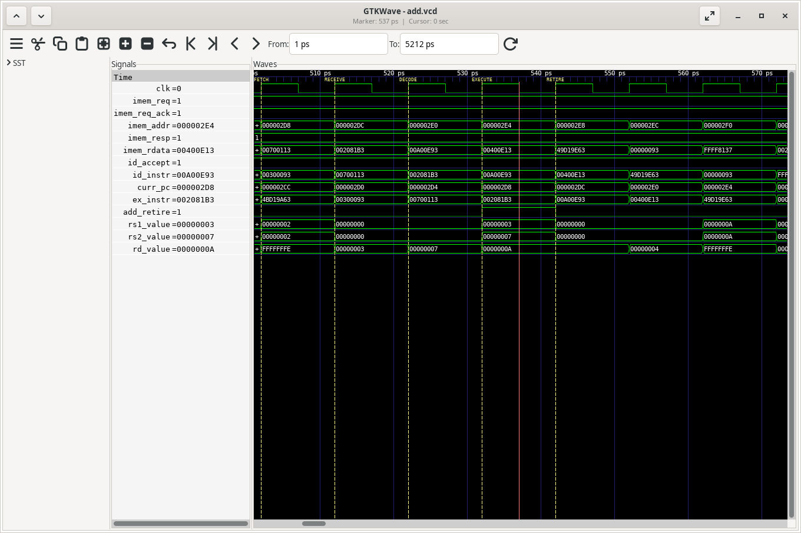

# Лабораторная работа 3

Вариант 3: команда `add`, вывод её атрибутов.

Для проверки использован тест `isa/rv32ui/add.S`. В тестбенч добавлен модуль `scr1_tb_log_cmd`, который при завершении `add` выводит адрес команды, машинный код, поля `opcode`, `funct3`, `funct7`, номера регистров, операнды и результат.

На диаграмме разобрана команда `add x3, x1, x2` по адресу `0x2d8`: в x1 находится 3, в x2 — 7, результат в x3 — 10. Видны запрос инструкции, получение из памяти, декодирование и исполнение. Пока эта команда исполняется, память уже получает запрос по другому адресу.

Тест завершился с `PASS`. Все 52 записи модуля сверены с дизассемблером и результатами сложения. Дополнительно запущены тесты `sub` и `mul`: оба прошли, ложных сообщений об `add` не было.

Проверено с Verilator 5.054, собранным из исходников, и RISC-V GCC 14.2.0. Конфигурация SCR1 — `MAX`, интерфейс — `AHB`.

Запуск из корня репозитория:

```bash
git submodule update --init --recursive
make clean
make run_verilator_wf TARGETS=riscv_isa BUS=AHB CFG=MAX TRACE=1
```

Результаты находятся в [report](report): [скриншот](report/waveform.png), [вывод модуля](report/debug.log), [дизассемблер](report/add.dump), [проверка SUB/MUL](report/negative_tests.log).

Посмотреть сохранённую диаграмму:

```bash
gtkwave report/add.vcd report/add.gtkw
```



Проверить сохранённый вывод:

```bash
python3 report/check_debug.py report/debug.log report/add.dump
```

Описание самого ядра: [SCR1 User Manual](docs/scr1_um.pdf) и [SCR1 External Architecture Specification](docs/scr1_eas.pdf).
